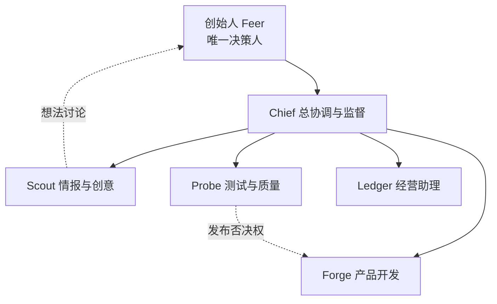
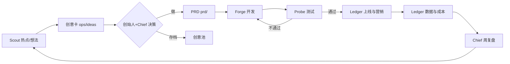

# 组织架构 v1

## 编制：首批 5 个岗位

你提的是 6 个职能：新闻与想法、产品开发、测试、营销、财务、总协调与监督。
我的建议是**首批 5 个岗位**：营销和财务先合并成「经营助理」，等到有第一笔收入（路线图 P2）再拆开。
原因是现在还没有收入，也没有投放预算，财务的工作主要是记账和控成本，营销的工作主要是做用户调研，一个人的工作量就够了。

| # | 岗位 | 代号 | 一句话职责 | 定义文件 |
|---|---|---|---|---|
| 1 | 总协调与监督 | **Chief** | 排优先级、派活、检查每个人的产出、盯风险和节点、写周复盘 | `.claude/agents/chief.md` |
| 2 | 情报与创意伙伴 | **Scout** | 每天整理 AI 软硬件热点，和你讨论想法，把想法写成创意卡和 PRD 草稿 | `.claude/agents/scout.md` |
| 3 | 产品开发 | **Forge** | 架构、写代码、维护代码库健康 | `.claude/agents/forge.md` |
| 4 | 测试与质量 | **Probe** | 测试、代码审查、安全扫描、模型评测；可以否决发布 | `.claude/agents/probe.md` |
| 5 | 经营助理（营销+财务） | **Ledger** | 用户调研、竞品、定价、内容计划；成本记账、预算和月报 | `.claude/agents/ledger.md` |

> 测试必须独立于开发：写代码的人不给自己验收。这是我坚持保留 Probe 单独一岗的原因。

## 汇报关系

## 一个想法怎么变成产品

## 职责分工（RACI）
R = 干活的人，A = 拍板的人，C = 要征求意见的人，I = 只需知情的人

| 事项 | 创始人 | Chief | Scout | Forge | Probe | Ledger |
|---|---|---|---|---|---|---|
| 战略与路线图 | A | R | C | C | I | C |
| 每日情报 | I | I | R | I | I | I |
| 创意 → PRD | A | C | R | C | C | C |
| 架构与开发 | I | A | I | R | C | I |
| 测试与发布 | A | C | I | C | R | I |
| 代码库健康与安全 | I | A | I | R | R | I |
| 定价与营销 | A | C | C | I | I | R |
| 预算与成本 | A | C | I | I | I | R |
| 进度、风险、节点 | I | R | I | C | C | C |

## 扩编计划
| 时间 | 新岗位 | 触发条件 |
|---|---|---|
| P1（2027 上半年） | 模型研究员 Lab | 开始做小模型微调与评测集 |
| P1 | 合规与伦理 Gate | moonrain 或 goforu 进入真实用户测试（情绪数据、未成年人） |
| P2（2027 下半年） | 营销 Echo、财务 Ledger 拆分 | 有第一笔收入 |
| P2 | 硬件产品工程师 Volt | 开始做硬件原型 |

在 Gate 上岗之前，合规检查由 Probe 执行，Chief 负责把关。
